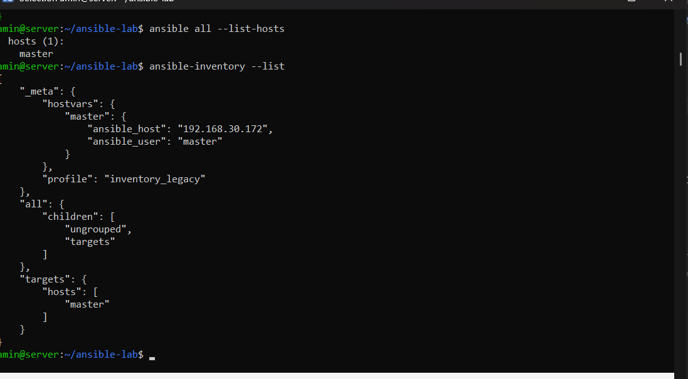
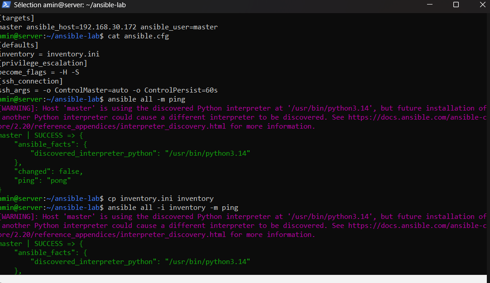
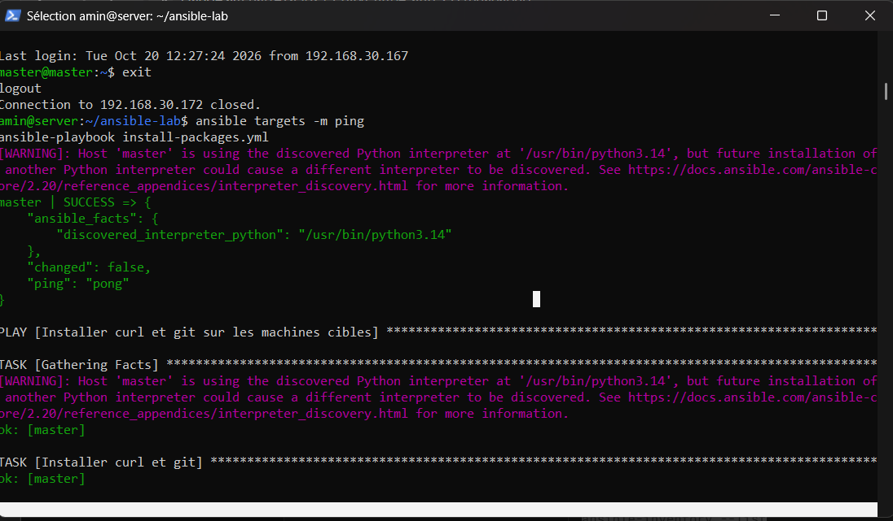
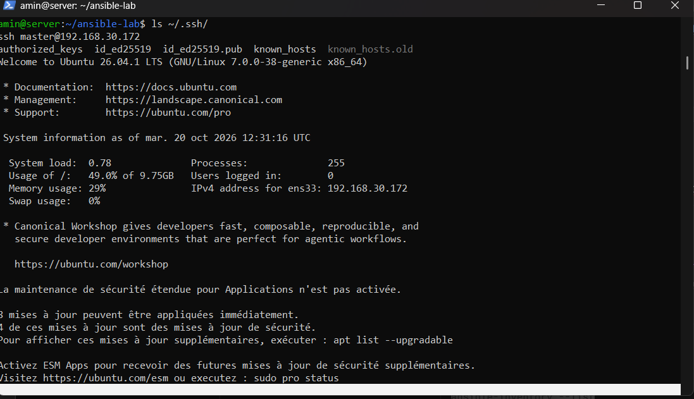

# TP Ansible : exercices 26, 27 et 28

## Environnement

| Machine | Rôle | Adresse IP |
|---|---|---|
| `server` | Nœud de contrôle (Ansible) | 192.168.30.167 |
| `master` | Serveur Ubuntu 26.04 cible | 192.168.30.172 |

## Fichiers

- `inventory` / `inventory.ini` : inventaire Ansible
- `ansible.cfg` : configuration Ansible
- `install-packages.yml` : installation de curl et git (exercice 27)
- `install-docker.yml` : installation de Docker (exercice 28)

---

## Exercice 26 : Inventory et ping

### Inventory

```ini
[targets]
master ansible_host=192.168.30.172 ansible_user=master
```

### Commandes

```bash
ansible all -i inventory -m ping
ansible all --list-hosts
ansible-inventory --list
```

### Résultat

```text
master | SUCCESS => {
    "changed": false,
    "ping": "pong"
}
```

### Captures d'écran






---

## Exercice 27 : Premier playbook, installation de packages

### Objectif

Créer un premier playbook Ansible qui installe automatiquement des packages Linux (`curl` et `git`) sur la machine cible.

### Playbook : `install-packages.yml`

```yaml
---
- name: Installer curl et git sur les machines cibles
  hosts: targets
  become: true

  tasks:
    - name: Installer curl et git
      ansible.builtin.apt:
        name:
          - curl
          - git
        state: present
        update_cache: true
```

### Exécution

```bash
ansible-playbook -i inventory.ini install-packages.yml --ask-pass --ask-become-pass
```

Résultat : `ok=2 changed=0 failed=0`. Les packages étaient déjà présents, le playbook est donc idempotent.

### Vérification

```bash
ansible -i inventory.ini targets -m command -a "curl --version" --ask-pass
ansible -i inventory.ini targets -m command -a "git --version" --ask-pass
```

Résultat : `curl 8.18.0` et `git version 2.53.0`.

### Captures d'écran

Exécution du playbook :


Vérification des versions :


---

## Exercice 28 : Installation automatique de Docker

### Objectif

Créer un playbook Ansible qui installe Docker sur une nouvelle VM Ubuntu, puis démarre et active le service.

### Playbook : `install-docker.yml`

```yaml
---
- name: Installer Docker sur les machines cibles
  hosts: targets
  become: true

  tasks:
    - name: Mettre à jour le cache APT
      ansible.builtin.apt:
        update_cache: true
        cache_valid_time: 3600

    - name: Installer Docker
      ansible.builtin.apt:
        name: docker.io
        state: present

    - name: Démarrer et activer le service Docker
      ansible.builtin.service:
        name: docker
        state: started
        enabled: true
```

### Exécution

```bash
ansible-playbook -i inventory.ini install-docker.yml --ask-pass --ask-become-pass
```

Résultat : `ok=4 changed=1 failed=0`. Docker a été installé lors de cette exécution (`changed=1` sur la tâche « Installer Docker »).

### Résultat de `docker --version`

```bash
ansible -i inventory.ini targets -m command -a "docker --version" --ask-pass
```

```text
master | CHANGED | rc=0 >>
Docker version 29.1.3, build 29.1.3-0ubuntu4.1
```

### Vérification du service

```bash
ansible -i inventory.ini targets -m command -a "systemctl is-active docker" --ask-pass
```

```text
master | CHANGED | rc=0 >>
active
```

### Capture d'écran


---

## Auteur

Amin Najjar
