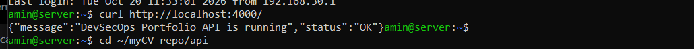
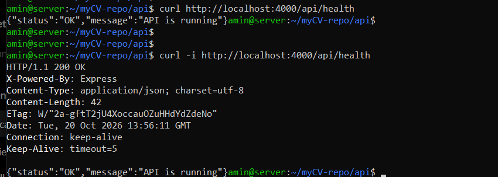

# API — DevSecOps Portfolio

## Objectif

Créer une application backend indépendante du frontend avec Node.js et Express.

## Technologies

- Node.js
- Express.js
- npm

## Structure du projet

```text
api/
├── node_modules/
├── package.json
├── package-lock.json
├── server.js
└── README.md
```

## Installation

```bash
cd api
npm install
```

## Démarrage du serveur

```bash
npm start
```

L'API écoute sur le port `4000` par défaut.

## Test

```bash
curl http://localhost:4000/
```

Réponse attendue :

```json
{
  "message": "DevSecOps Portfolio API is running",
  "status": "OK"
}
```

## Capture d'écran




## Exercice 30 — Route GET `/api/health`

### Objectif

Créer une route permettant de vérifier que l'API fonctionne correctement.

### Endpoint

`GET /api/health`

### Implémentation

```javascript
app.get("/api/health", (req, res) => {
  res.status(200).json({
    status: "OK",
    message: "API is running"
  });
});
```

### Test

```bash
curl http://localhost:4000/api/health
```

### Résultat attendu

```json
{
  "status": "OK",
  "message": "API is running"
}
```

La route retourne le statut HTTP `200 OK` lorsque l'API répond correctement.

### Capture d'écran




## Auteur

Amin Najjar
